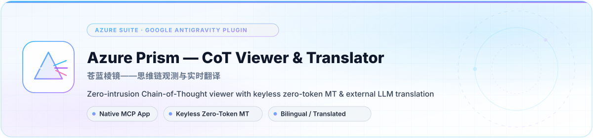
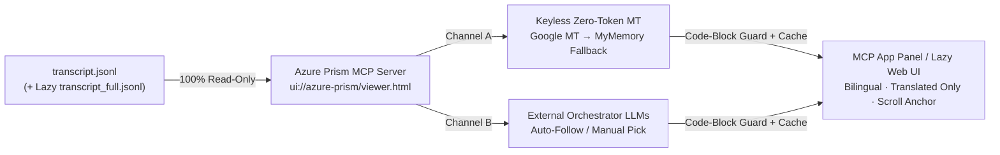
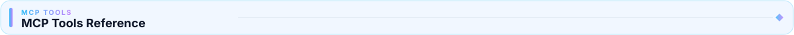
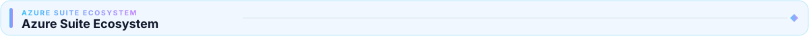

<div align="center">

<p>🌐 &nbsp; <a href="README.md">简体中文</a> &nbsp;·&nbsp; <strong>English</strong></p>

<picture>
  <source media="(prefers-color-scheme: dark)" srcset="assets/readme/hero-en-dark.svg">
  
</picture>

<p>
  [](https://github.com/A16Nights/antigravity-azure-prism/releases)
  [](https://github.com/A16Nights/antigravity-azure-prism/stargazers)
  
  
  
  [](./LICENSE)
</p>

<p>
  <strong>Native MCP App Chain-of-Thought viewer with lazy full-transcript loading, keyless zero-token MT, and external LLM translation</strong>
</p>

<p>
  <a href="#features">✨ Features</a> &nbsp;·&nbsp; <a href="#architecture">🧩 Architecture</a> &nbsp;·&nbsp; <a href="#installation">🚀 Quick Start</a> &nbsp;·&nbsp; <a href="#mcp-tools">🧰 MCP Tools</a> &nbsp;·&nbsp; <a href="#storage">📂 Storage</a> &nbsp;·&nbsp; <a href="#azure-suite">🌌 Azure Suite</a>
</p>

</div>

A zero-intrusion Chain-of-Thought (`thinking`) viewer, search panel, and multi-channel Chinese translator for **Google Antigravity** (native MCP App + on-demand standalone Web UI). Reads local transcripts (`transcript.jsonl` / `transcript_full.jsonl`) strictly read-only without interfering with the active conversation or consuming primary context tokens.

<table>
<tr>
<td width="50%" valign="top">
<h4>🔮 Zero-Intrusion CoT Parsing</h4>
Reads <code>PLANNER_RESPONSE.thinking</code>, <code>CHECKPOINT</code>, and <code>USER_INPUT</code>; lazily hydrates truncated thoughts from <code>transcript_full.jsonl</code> with 3.5s adaptive polling & scroll anchoring.
</td>
<td width="50%" valign="top">
<h4>🌐 Keyless Zero-Token MT + LLMs</h4>
Pick any External Orchestrator model or use built-in keyless <code>mt:google</code> translation (with Markdown code-block placeholders & MyMemory fallback), cached locally.
</td>
</tr>
<tr>
<td width="50%" valign="top">
<h4>📖 Bilingual / Translated-Only Toggle</h4>
Persisted segmented switch between <code>Bilingual</code> and <code>Translated Only</code> views, plus per-card temporary Show/Hide Original buttons.
</td>
<td width="50%" valign="top">
<h4>🪶 Native MCP App · Zero Idle Ports</h4>
Embeds natively via <code>ui://azure-prism/viewer.html</code> with zero background ports; spawns a loopback HTTP server lazily only when you click <code>Web UI</code>.
</td>
</tr>
</table>

<h2 id="features">
<picture>
  <source media="(prefers-color-scheme: dark)" srcset="assets/readme/sec-features-en-dark.svg">
  
</picture>
</h2>

### 1. Zero-Intrusion Live CoT Parsing & Lazy Truncation Hydration
- **Strictly Read-Only Log Reader**: Scans `~/.gemini/antigravity/brain/<conversation-id>/.system_generated/logs/transcript.jsonl` to extract `PLANNER_RESPONSE.thinking` (with tool call names), `CHECKPOINT` compaction boundaries, and `USER_INPUT` turns.
- **Automatic Full-Text Hydration**: Whenever `truncated_fields` includes `thinking`, lazily reads the exact line from `transcript_full.jsonl` for complete untruncated reasoning.
- **3.5s Adaptive Polling & Scroll Anchoring**: Silently refreshes live thinking steps and compensates scroll offset whenever cards expand or translations arrive above the viewport.

### 2. Multi-Channel Translation (Orchestrator LLMs + Keyless Zero-Token MT)
- **Translation Channel Selector (`#channel-select`)**:
  - **Auto-Follow Orchestrator**: Reuses **[External Orchestrator](https://github.com/A16Nights/antigravity-external-orchestrator)** models in `fast` → `default` → first-enabled order;
  - **Pick Any External Model**: Manually select any enabled provider and model;
  - **Built-in Keyless Zero-Token MT (`mt:google`)**: Works out of the box with zero API keys and zero LLM tokens, featuring Markdown code-block & inline-code placeholder protection, paragraph chunking, and automatic fallback to MyMemory on rate limits.
- **Auto-Translate, On-Demand Re-Translate & Local Cache**: Auto-translate incoming English thoughts or click `译` on any card to translate / re-translate with a newly chosen model; persisted in `~/.gemini/azure-prism/translation-cache.json` with smart CJK-ratio skip detection.

### 3. Bilingual / Translated-Only View Modes
- Persisted segmented switch in the status bar:
  - **Bilingual**: Shows original reasoning above and the model-labeled Chinese translation below;
  - **Translated Only**: Hides English source text on translated cards while keeping a per-card **Show/Hide Original** shortcut (untranslated cards still display source text).

### 4. Smart Filtering & Folding Controls
- Switch across recent conversations with live thought counts and timestamps; filter with real-time keyword highlighting, toggle **Thinking Only / All Steps**, or **Expand / Collapse All**.

### 5. Native MCP App + On-Demand Web UI + Unified Azure Suite UI
- **Native MCP App**: Embedded via `_meta.ui.resourceUri` (`ui://azure-prism/viewer.html`) with zero idle ports; click `Web UI` to launch an on-demand local loopback server in your browser.
- **Neko Glass UI & Shared Theme Center**: Dark/light themes, unified glass dropdowns (`AzureSelect`), 6 official presets + custom dual pickers + 4 shared slots, sidebar toggle, and GitHub Release update checks.

<h2 id="architecture">
<picture>
  <source media="(prefers-color-scheme: dark)" srcset="assets/readme/sec-arch-en-dark.svg">
  
</picture>
</h2>



<h2 id="installation">
<picture>
  <source media="(prefers-color-scheme: dark)" srcset="assets/readme/sec-install-en-dark.svg">
  
</picture>
</h2>

> **Prerequisite**: **Node.js >= 20.0.0** (zero third-party npm dependencies, pure native ESM).

### Option 1 · Let Antigravity Install It for You (Recommended)

Copy and send the following prompt directly to Antigravity:

> Please clone `https://github.com/A16Nights/antigravity-azure-prism.git` into my Antigravity global plugins directory as `azure-prism`, verify the directory structure, and tell me once it is ready so I can press `Ctrl+R` to reload.

### Option 2 · Manual Git Clone

```powershell
# Windows (PowerShell)
git clone https://github.com/A16Nights/antigravity-azure-prism.git "$env:USERPROFILE\.gemini\config\plugins\azure-prism"

# macOS / Linux
git clone https://github.com/A16Nights/antigravity-azure-prism.git ~/.gemini/config/plugins/azure-prism
```

Restart or reload Antigravity (`Ctrl+R`), enable **Azure Prism** in **Plugins**, and open it from the left sidebar or via `azure_prism_open`.

<h2 id="mcp-tools">
<picture>
  <source media="(prefers-color-scheme: dark)" srcset="assets/readme/sec-tools-en-dark.svg">
  
</picture>
</h2>

| Tool | Description |
| --- | --- |
| `azure_prism_open` | Open the Azure Prism Chain-of-Thought viewer in Antigravity's side pane or full panel |
| `azure_prism_api` | Internal panel API (fetch snapshots, trigger translation, switch model/display mode, manage theme & sidebar, launch standalone Web UI, check updates) |

<h2 id="storage">
<picture>
  <source media="(prefers-color-scheme: dark)" srcset="assets/readme/sec-storage-en-dark.svg">
  
</picture>
</h2>

<details open>
<summary><strong>Click to inspect local data paths & shared Azure Suite configs</strong></summary>

<br>

- **Prism Preferences**: `~/.gemini/azure-prism/config.json` (auto-migrates legacy `~/.gemini/thought-viewer/` data)
- **Persistent Translation Cache**: `~/.gemini/azure-prism/translation-cache.json`
- **Shared Azure Suite Theme & Sidebar Config**: `~/.gemini/azure-theme.json`, `~/.gemini/azure-sidebar-nav.json`

</details>

<h2 id="azure-suite">
<picture>
  <source media="(prefers-color-scheme: dark)" srcset="assets/readme/sec-suite-en-dark.svg">
  
</picture>
</h2>

All **8 Azure Suite plugins** share a unified **Neko Glass UI**, synchronized **Azure Theme Center** (`~/.gemini/azure-theme.json`), and customizable **Sidebar Navigation Hub** (`~/.gemini/azure-sidebar-nav.json`):

| Plugin | Repository | Core Capability |
| --- | --- | --- |
| ✦ **External Orchestrator** | [antigravity-external-orchestrator](https://github.com/A16Nights/antigravity-external-orchestrator) | Multi-provider external worker routing, custom profiles, circuit breaker & live monitoring |
| 🪐 **Azure Orbit** | [antigravity-azure-orbit](https://github.com/A16Nights/antigravity-azure-orbit) | Mount external LLM APIs directly into Antigravity's native bottom-left model selector |
| 🧭 **Azure Compass** | [antigravity-azure-compass](https://github.com/A16Nights/antigravity-azure-compass) | Agent mode presets, live context telemetry with auto /compact & Azure Suite sidebar hub |
| 🏛️ **Azure Corridor** | [antigravity-azure-corridor](https://github.com/A16Nights/antigravity-azure-corridor) | Read-only FTS5 conversation search, custom project groups, priority tags & safe archive |
| 🌌 **Lanxi Memory** | [antigravity-lanxi-memory](https://github.com/A16Nights/antigravity-lanxi-memory) | 5-layer Markdown cognitive graph, CJK FTS5, tidal forgetting curves & starfield UI |
| 💎 **Soul.md Studio** | [antigravity-soul-md](https://github.com/A16Nights/antigravity-soul-md) | Hot-swappable persona cards, workspace binding, external-model anchor & layered memory |
| 💭 **Think-ZH** | [antigravity-think-zh](https://github.com/A16Nights/antigravity-think-zh) | Simplified Chinese / English reasoning switcher with dual-channel anti-drift hooks |
| 🔮 **Azure Prism** &nbsp;`✦ This Repo` | [antigravity-azure-prism](https://github.com/A16Nights/antigravity-azure-prism) | Native MCP App Chain-of-Thought viewer with keyless zero-token MT & LLM translation |

---

<div align="center">

📄 Released under the **[MIT License](./LICENSE)** · Crafted for **Google Antigravity**

</div>
