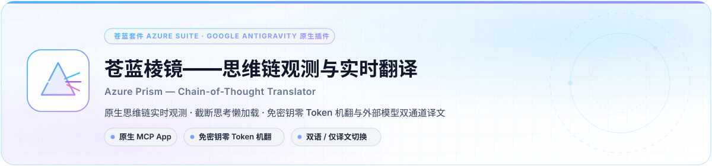
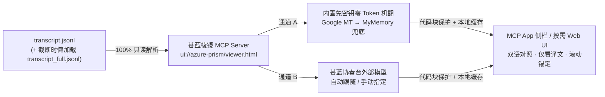

<div align="center">

<p>🌐 &nbsp; <strong>简体中文</strong> &nbsp;·&nbsp; <a href="README.en.md">English</a></p>

<picture>
  <source media="(prefers-color-scheme: dark)" srcset="assets/readme/hero-dark.svg">
  
</picture>

<p>
  [](https://github.com/A16Nights/antigravity-azure-prism/releases)
  [](https://github.com/A16Nights/antigravity-azure-prism/stargazers)
  
  
  
  [](./LICENSE)
</p>

<p>
  <strong>原生 MCP App 思维链实时观测面板 · 截断思考懒加载 · 免密钥零 Token 机翻与外部模型双通道译文</strong>
</p>

<p>
  <a href="#features">✨ 功能全景</a> &nbsp;·&nbsp; <a href="#architecture">🧩 工作原理</a> &nbsp;·&nbsp; <a href="#installation">🚀 快速安装</a> &nbsp;·&nbsp; <a href="#mcp-tools">🧰 MCP 工具</a> &nbsp;·&nbsp; <a href="#storage">📂 数据存储</a> &nbsp;·&nbsp; <a href="#azure-suite">🌌 苍蓝全家桶</a>
</p>

</div>

面向 **Google Antigravity** 的原生模型思维链（Chain of Thought / Thinking）实时观测、检索与多通道中文翻译面板（原生 MCP App 侧栏面板 + 按需本地独立 Web UI）。100% 只读解析本地会话日志（`transcript.jsonl` / `transcript_full.jsonl`），不干扰主对话、不消耗主脑上下文窗口。

<table>
<tr>
<td width="50%" valign="top">
<h4>🔮 零侵入实时思维链解析</h4>
只读解析 <code>PLANNER_RESPONSE.thinking</code>、<code>CHECKPOINT</code> 与 <code>USER_INPUT</code>；遇截断字段自动按行懒加载 <code>transcript_full.jsonl</code>，3.5 秒自适应轮询 + 滚动锚定。
</td>
<td width="50%" valign="top">
<h4>🌐 免密钥零 Token 机翻 + 外部模型</h4>
支持自选苍蓝协奏台任意模型或内置免密钥 <code>mt:google</code> 机翻（带代码块占位保护与 MyMemory 自动兜底），译文持久化本地缓存。
</td>
</tr>
<tr>
<td width="50%" valign="top">
<h4>📖 双语对照 / 仅看译文一键切</h4>
状态栏提供 <code>双语</code> / <code>仅译文</code> 持久化分段开关；仅译文模式下每张卡片仍可单条临时展开或收起原文。
</td>
<td width="50%" valign="top">
<h4>🪶 原生 MCP App · 常驻零端口</h4>
基于 <code>ui://azure-prism/viewer.html</code> 原生嵌入侧栏，零后台端口占用；点击 <code>Web UI</code> 才按需懒启动本地回环服务。
</td>
</tr>
</table>

<h2 id="features">
<picture>
  <source media="(prefers-color-scheme: dark)" srcset="assets/readme/sec-features-dark.svg">
  
</picture>
</h2>

### 1. 零侵入实时思维链解析与懒加载补全
- **只读解析原生日志**：自动扫描 `~/.gemini/antigravity/brain/<conversation-id>/.system_generated/logs/transcript.jsonl`，精准提取：
  - `PLANNER_RESPONSE.thinking`（模型每一步的完整内部推理链与对应工具调用名）；
  - `CHECKPOINT`（原生 `/compact` 上下文压缩分界线与摘要）；
  - `USER_INPUT`（用户每轮提问节点，形成清晰的问答思考脉络）。
- **截断思考自动补全**：当紧凑日志中 `truncated_fields` 包含 `thinking` 时，自动按对应行号从 `transcript_full.jsonl` 懒加载完整未截断思考内容。
- **3.5 秒自适应轮询 + 滚动锚定保护**：对话进行时自动静默刷新最新思考步骤；当视口上方卡片展开或译文回填导致高度变化时，自动补偿滚动位移，绝不打断当前阅读位置。

### 2. 多通道中文翻译（协奏台外部模型 + 内置免密钥零 Token 机器翻译）
- **自选翻译模型下拉选择器（`#channel-select`）**：
  - **自动跟随协奏台**：自动按 `fast` → `default` → 首个已启用渠道顺序复用 **[苍蓝协奏台](https://github.com/A16Nights/antigravity-external-orchestrator)** 的模型配置；
  - **手动指定任意外部模型**：可从下拉列表中直接选用苍蓝协奏台已启用的任意提供商与模型；
  - **内置免密钥 · 零 Token 机器翻译（`mt:google`）**：无需配置任何 API Key、不消耗任何大模型 Token，开箱即用实时翻译英文思考过程；内置 **Markdown 代码块与行内代码占位符保护**、长文本按自然段智能切分，并在 Google 翻译偶发限流时 **自动无缝降级至 MyMemory 免费翻译接口兜底**。
- **自动翻译 / 单条按需重译 + 本地持久化缓存**：
  - 支持开启「自动翻译」实时翻译新增英文思考，或点击单张卡片右上角 `译` 按钮按需翻译 / 使用当前新选模型强制重译；
  - 译文自动持久化缓存在本地 `~/.gemini/azure-prism/translation-cache.json`（含中英文占比智能跳过判断，纯中文思考不重复发起翻译）。

### 3. 「双语对照 / 仅看译文」一键切换
- 状态栏提供 **`双语` / `仅译文`** 分段切换开关（自动持久化到配置）：
  - **双语模式**：上方保留完整原文，下方展示带模型/渠道标注的中文译文区块；
  - **仅译文模式**：已翻译的思考卡片自动隐藏英文原文、仅展示清爽的中文译文，同时在译文右上角提供单条临时的 **`查看原文` / `隐藏原文`** 快捷按钮；尚未翻译的卡片仍正常显示原文不留白。

### 4. 双行智能筛选与卡片折叠控制
- **会话切换与状态指示**：支持在最近活跃的多个会话之间自由切换，实时显示各会话的思考步数与最后活跃时间。
- **关键词检索 & 仅看含思考步**：支持按关键词实时高亮过滤思考内容、一键切换「仅含思考 / 全部节点」、一键「全部展开 / 全部折叠」。

### 5. 原生 MCP App + 按需独立 Web UI + 苍蓝统一视觉体系
- **原生 MCP App 架构**：基于 `_meta.ui.resourceUri`（`ui://azure-prism/viewer.html`）直接嵌入 Antigravity 侧栏或全局面板，常驻零端口占用；点击顶栏 `Web UI` 按钮时按需懒启动本地回环 HTTP 服务并在系统默认浏览器全屏打开。
- **Neko Glass 毛玻璃界面 & 苍蓝主题色调中心**：深色/浅色切换、全量统一毛玻璃下拉框（`AzureSelect`）、7px 细圆角滚动条、6 套官方主题预设 + 自定义双色 + 4 个自定义栏位跨插件同步、左侧栏快捷入口开关与 GitHub Release 在线更新检查。

<h2 id="architecture">
<picture>
  <source media="(prefers-color-scheme: dark)" srcset="assets/readme/sec-arch-dark.svg">
  
</picture>
</h2>



<h2 id="installation">
<picture>
  <source media="(prefers-color-scheme: dark)" srcset="assets/readme/sec-install-dark.svg">
  
</picture>
</h2>

> **前置要求**：**Node.js >= 20.0.0**（零第三方 npm 运行时依赖，纯 Node.js 原生 ESM 实现）。

### 方式一 · 一句话让 Antigravity 帮你自动安装（推荐）

直接把下面这句话发给 Antigravity 即可自动完成克隆与核验：

> 帮我把 `https://github.com/A16Nights/antigravity-azure-prism.git` 克隆到本机 Antigravity 全局插件目录，目录名设为 `azure-prism`，检查目录无误后告诉我，我再按 `Ctrl+R` 重载生效。

### 方式二 · 命令行手动克隆

```powershell
# Windows (PowerShell)
git clone https://github.com/A16Nights/antigravity-azure-prism.git "$env:USERPROFILE\.gemini\config\plugins\azure-prism"

# macOS / Linux
git clone https://github.com/A16Nights/antigravity-azure-prism.git ~/.gemini/config/plugins/azure-prism
```

重启或重载 Antigravity（`Ctrl+R`），在 **Plugins** 面板启用 **苍蓝棱镜**，即可从左侧栏快捷入口或通过 MCP 工具 `azure_prism_open` 打开面板。

<h2 id="mcp-tools">
<picture>
  <source media="(prefers-color-scheme: dark)" srcset="assets/readme/sec-tools-dark.svg">
  
</picture>
</h2>

| 工具名 | 作用 |
| --- | --- |
| `azure_prism_open` | 在 Antigravity 侧边栏或全局面板中打开苍蓝棱镜思维链观测界面 |
| `azure_prism_api` | 面板内部数据与控制接口（拉取会话思考快照、触发翻译、切换翻译模型/显示模式、管理主题与左侧栏开关、启动独立 Web UI、检查更新） |

<h2 id="storage">
<picture>
  <source media="(prefers-color-scheme: dark)" srcset="assets/readme/sec-storage-dark.svg">
  
</picture>
</h2>

<details open>
<summary><strong>点击展开查看本机数据目录与苍蓝套件共享配置路径</strong></summary>

<br>

- **棱镜偏好配置**：`~/.gemini/azure-prism/config.json`（自动兼容迁移旧版 `~/.gemini/thought-viewer/` 数据）
- **译文持久化缓存**：`~/.gemini/azure-prism/translation-cache.json`
- **苍蓝套件共享主题 / 左侧栏配置**：`~/.gemini/azure-theme.json`、`~/.gemini/azure-sidebar-nav.json`

</details>

<h2 id="azure-suite">
<picture>
  <source media="(prefers-color-scheme: dark)" srcset="assets/readme/sec-suite-dark.svg">
  
</picture>
</h2>

**苍蓝套件（Azure Suite）** 8 款插件共享统一的 **Neko Glass 毛玻璃界面**、跨插件同步的 **苍蓝主题色调中心**（`~/.gemini/azure-theme.json`）以及可自由开关的 **左侧栏快捷入口**（`~/.gemini/azure-sidebar-nav.json`）：

| 插件 | 仓库 | 核心能力 |
| --- | --- | --- |
| ✦ **苍蓝协奏台** | [antigravity-external-orchestrator](https://github.com/A16Nights/antigravity-external-orchestrator) | 多渠道外部模型协同调度、自定义调度角色、容灾断路器与全链路实时监控 |
| 🪐 **苍蓝星轨** | [antigravity-azure-orbit](https://github.com/A16Nights/antigravity-azure-orbit) | 将外部大模型直接挂载进 Antigravity 左下角原生模型下拉菜单担任主脑 |
| 🧭 **苍蓝罗盘** | [antigravity-azure-compass](https://github.com/A16Nights/antigravity-azure-compass) | Agent 工作模式预设中心、上下文水位监测与自动 /compact、苍蓝套件左侧栏总控 |
| 🏛️ **苍蓝回廊** | [antigravity-azure-corridor](https://github.com/A16Nights/antigravity-azure-corridor) | 只读原生会话 FTS5 全文检索、自定义项目分组、优先级标签与独立安全归档箱 |
| 🌌 **蓝汐 · 潮汐认知图谱** | [antigravity-lanxi-memory](https://github.com/A16Nights/antigravity-lanxi-memory) | 五层纯 Markdown 真源记忆、CJK FTS5、潮汐遗忘曲线与交互式潮汐星海图谱 |
| 💎 **苍蓝魂匣** | [antigravity-soul-md](https://github.com/A16Nights/antigravity-soul-md) | 多人设卡热切换、工作区专属绑定、外接模型智能防掉线锚点与分层文件记忆 |
| 💭 **思语中文** | [antigravity-think-zh](https://github.com/A16Nights/antigravity-think-zh) | 内部思考语言简体中文 / 英文双档热切换、双通道防漂移与实时注入预览 |
| 🔮 **苍蓝棱镜** &nbsp;`✦ 当前仓库` | [antigravity-azure-prism](https://github.com/A16Nights/antigravity-azure-prism) | 原生 MCP App 思维链实时观测、免密钥零 Token 机翻与外部模型双通道译文 |

---

<div align="center">

📄 Released under the **[MIT License](./LICENSE)** · Crafted for **Google Antigravity**

</div>
